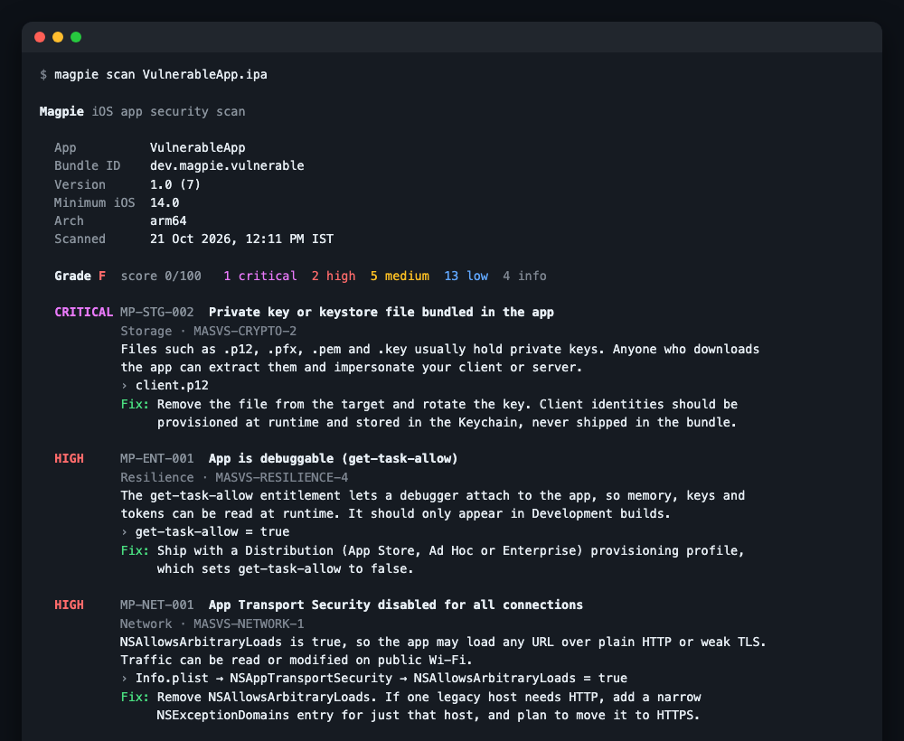
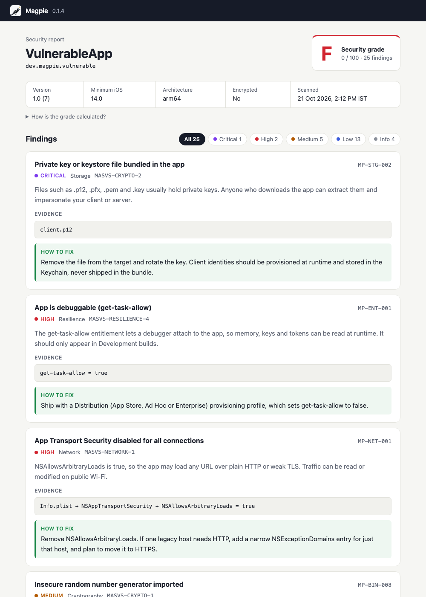
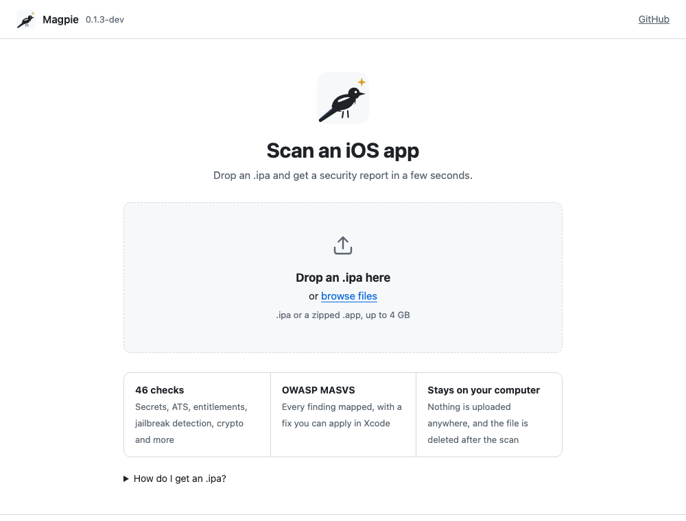

<div align="center">


# Magpie

**Find the shiny things you left in your iOS app.**

A fast, single-binary security scanner for iOS apps. Drop in an `.ipa` and in about a second Magpie shows what an attacker would find: leaked API keys, disabled App Transport Security, debuggable builds, weak crypto, missing jailbreak detection, staging URLs and more, each with a plain-English fix.

[](https://github.com/Kumar-ranjan12345/magpie/actions/workflows/ci.yml)
[](https://github.com/Kumar-ranjan12345/magpie/releases)
[](go.mod)
[](LICENSE)
[](https://mas.owasp.org/MASVS/)

</div>

<p align="center">
  
  
</p>

## Why Magpie

- **Built for iOS.** It reads Mach-O binaries, Info.plist, entitlements and code signatures directly. It's not an Android tool with iOS bolted on.
- **Two ways to use it.** Run `magpie scan` in a terminal, or `magpie serve` to drag and drop an IPA in your browser.
- **Nothing to set up.** One binary for macOS, Linux and Windows. No Python, Docker, server or account.
- **Your app never leaves your computer.** Everything runs locally, which matters when the app isn't released yet.
- **Made for developers.** Every finding says why it matters and exactly what to change in Xcode, and maps to [OWASP MASVS](https://mas.owasp.org/MASVS/).
- **Ready for CI.** JSON and SARIF output, plus `-fail-on` exit codes that can block a risky build.

## Install

**Homebrew** (macOS and Linux)

```sh
brew tap kumar-ranjan12345/magpie https://github.com/Kumar-ranjan12345/magpie
brew trust kumar-ranjan12345/magpie   # newer Homebrew versions ask you to trust a third-party tap once
brew install magpie
```

**Download a binary.** Grab the archive for your platform from [Releases](https://github.com/Kumar-ranjan12345/magpie/releases), unpack it and put `magpie` on your `PATH`. On macOS, clear the download quarantine once with `xattr -d com.apple.quarantine magpie`.

**With Go 1.23 or later**

```sh
go install github.com/Kumar-ranjan12345/magpie/cmd/magpie@latest
```

## Usage

### 1. Drag and drop

```sh
magpie serve
```

Your browser opens at `http://127.0.0.1:8077`. Drop an `.ipa` (or a zipped `.app`) on the page and the report appears, with buttons to save it or scan another app. The server only listens on your own machine, and each upload is deleted as soon as its scan finishes.

<p align="center"></p>

### 2. Terminal

```sh
magpie scan MyApp.ipa                                 # coloured report in the terminal
magpie scan MyApp.app                                 # an .app folder works too
magpie scan MyApp.ipa -format html -o report.html     # shareable report page
magpie scan MyApp.ipa -format json -o report.json     # for scripts
magpie scan MyApp.ipa -format sarif -o magpie.sarif   # for GitHub code scanning
magpie scan MyApp.ipa -fail-on high                   # exit 1 on high or critical findings
magpie rules                                          # list every check
```

Exit codes: `0` ok · `1` findings at or above `-fail-on` · `2` error.

### Which build to scan

Use a build you produced yourself: **Xcode → Product → Archive**, then either export an `.ipa` (Distribute App → Ad Hoc or Development) or scan `Products/Applications/YourApp.app` inside the `.xcarchive`. IPAs downloaded from the App Store are FairPlay-encrypted; Magpie detects that and still checks Info.plist, entitlements and bundled files, but can't read strings in the code.

### In CI (GitHub Actions)

```yaml
- name: Scan the IPA with Magpie
  run: |
    go install github.com/Kumar-ranjan12345/magpie/cmd/magpie@latest
    magpie scan build/MyApp.ipa -format sarif -o magpie.sarif -fail-on high

- name: Show findings in GitHub code scanning
  if: always()
  uses: github/codeql-action/upload-sarif@v3
  with:
    sarif_file: magpie.sarif
```

## What it checks

46 rules across 9 areas. Run `magpie rules` for the full list.

| Area | Examples |
|---|---|
| **Secrets** | AWS, Stripe, GitHub, Slack, OpenAI, Anthropic, Twilio and SendGrid keys, PEM private keys, JWTs, Google API keys |
| **Network** | ATS disabled globally or for web content, insecure-HTTP and old-TLS exceptions, cleartext URLs, pinned certificates |
| **Entitlements** | `get-task-allow` (debuggable), development push, wildcard keychain groups |
| **Resilience** | Jailbreak detection, anti-debugging (`ptrace`, `sysctl`), Frida and Substrate detection, App Attest and DeviceCheck, protection SDKs such as IOSSecuritySuite, freeRASP and iXGuard |
| **Crypto** | MD5 and SHA-1, `rand()`, legacy `CCCrypt` |
| **Binary hardening** | PIE, stack canaries, ARC, stripped symbols, embedded debug info, unsafe C functions |
| **Storage** | Documents exposed in the Files app, bundled keystores, databases and `.env` files |
| **Supply chain and privacy** | Embedded framework inventory with versions, analytics and ad SDKs, outdated OpenSSL |
| **Build hygiene** | localhost and staging URLs, source files or `.xcconfig` in the bundle, old deployment targets, custom URL schemes, background modes |

## Grading

Every finding takes points off 100: critical 30, high 15, medium 8, low 3, info 0. The score maps to a grade from A to F. A critical finding caps the grade at D and a high finding at C, so one leaked key can't hide behind an otherwise clean app.

## Limitations

Magpie is a fast static check of the **built app**, not a replacement for source-code analysis or a penetration test.

- **It reads the app, it doesn't run it.** It can see that `CCCrypt` is linked in, not whether it's used with ECB mode or a static IV.
- **It detects protections, it doesn't rate them.** It can tell that an app checks for jailbreaks or Frida, not how easily those checks are bypassed. Obfuscated or commercial protections may not be visible at all.
- **Statically linked libraries aren't listed separately.** Most Swift packages become part of the main executable, so the SDK inventory only covers embedded frameworks.
- **App Store downloads are encrypted**, which limits checks on the code.

Use it alongside SAST tools for source code and dynamic testing (Frida, a proxy, a jailbroken device) for anything that matters.

## Responsible use

Only scan apps you own or are authorised to test. Magpie redacts secrets in its output, but reports can still reveal internal details, so treat them as confidential.

## Development

```sh
go test ./...
go run ./cmd/magpie scan testdata/VulnerableApp.app   # grade F, every issue planted
go run ./cmd/magpie scan testdata/ProtectedApp.app    # grade A, with runtime protections
```

The two fixture apps in `testdata/` are built from the sources in `testdata/src`:

```sh
cd testdata/src
SDK="$(xcrun --sdk iphoneos --show-sdk-path)"

xcrun clang -arch arm64 -isysroot "$SDK" -miphoneos-version-min=14.0 -fno-stack-protector -O0 -g \
  vulnerable.c -o ../VulnerableApp.app/VulnerableApp
codesign -f -s - --entitlements entitlements.plist ../VulnerableApp.app/VulnerableApp

xcrun clang -arch arm64 -isysroot "$SDK" -miphoneos-version-min=16.0 -fobjc-arc -Os \
  protected.m -framework Foundation -framework DeviceCheck -o ../ProtectedApp.app/ProtectedApp
strip -x ../ProtectedApp.app/ProtectedApp && codesign -f -s - ../ProtectedApp.app/ProtectedApp
```

Releases are built by [GoReleaser](https://goreleaser.com) when a `v*` tag is pushed. The workflow publishes the binaries and updates the Homebrew formula in `Formula/`.

## Roadmap

- [ ] Swift source checks (secrets and PII in logs, insecure Keychain and UserDefaults usage, trust-all TLS delegates)
- [ ] Known-vulnerable SDK versions
- [ ] A reusable GitHub Action
- [ ] Android APK support

Issues and pull requests are welcome.

## License

[MIT](LICENSE) © [Kumar Ranjan Kamila](https://kumarranjan.vercel.app)
